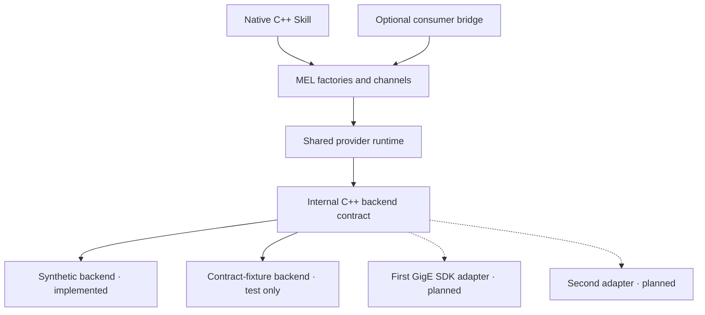

# AMS-GRA GigE MEL Provider

A native C++20 **provider** of the AMS-GRA infrared MFA Encapsulation Layer,
with a common MEL implementation and interchangeable camera backends.

**Status: working, hardware-independent bootstrap.** The shared library exports
the real upstream MEL factories, a synthetic camera delivers Mono8 frames into
consumer-registered host memory, and camera controls work through C2 and Image
channels. This is an **experimental image-stream profile**, not a complete MEL
4.0 implementation and not yet a GigE Vision hardware driver. The
[surface roadmap](docs/mel-surface-roadmap.md) explicitly lists the remaining
required, conditional, and optional API work.

The first implementation is C++. The separate
[`ams-gra-mel-bridge`](https://github.com/zackboll/ams-gra-mel-bridge) project is a
consumer bridge; it is not required to build or use this provider. This project
does not introduce a provider-facing C ABI or multilingual provider SDK.

## Quick start

Requirements: Linux, a C++20 compiler (GCC 13 is the locally validated compiler),
CMake **3.24+**, Ninja, and Python **3.9+**. No camera, commercial SDK, network
access, package manager, or downloaded dependency is needed by the build itself.

From the repository root:

```sh
cmake --preset dev
cmake --build --preset dev --parallel 2
ctest --preset dev

./build/dev/mel_capture ./build/dev/libgige_mel_provider.so ./build/dev/capture.pgm
```

The example loads the provider with `dlopen` and `dlsym`; it links only the
upstream headers, threads, and dynamic loader. It captures one 64×48 image and
writes binary PGM. The synthetic pixel value is
`(x + y + native_frame_id) & 255`. The printed time is a synthetic monotonic
integration-start timestamp with **no UTC epoch**.

Without Ninja, use the generator-independent commands:

```sh
cmake -S . -B build/make -G "Unix Makefiles" -DCMAKE_BUILD_TYPE=Debug
cmake --build build/make --parallel 2
ctest --test-dir build/make --output-on-failure
```

## What is implemented

[Partial Health reporting](docs/health-status.md) exposes current provider
readiness/acquisition state and cumulative diagnostics through the pinned public
MEL API. Reports are best-effort 100 ms snapshots, not an event log or physical
camera-health certificate. Health can stop independently of Image acquisition.

[Provider-software BIT](docs/software-bit.md) adds one bounded observed-state
check through C2, a catalogue and latest result/current software faults through
C2 and Health. Command execution success is distinct from a test Pass/Fail. It
performs no device I/O and does not certify connectivity or future acquisition.

[Provider software subsystem status](docs/subsystem-status.md) publishes Health
`SubsystemStatusResp` for one software subsystem containing this provider's CSCI
(version 0.1.0): current readiness, a committed BIT-state revision and a
prepared-report sequence. It is not a physical inventory, criticality rating or
camera connection probe.

| Area | Bootstrap behavior |
| --- | --- |
| Dynamic factories | Exact `getAPI_Manager`, `getControl`, and `getBuffer` symbols |
| Provider initialization | Explicit `synthetic` instance, stable `synthetic-0` device, idempotent initialization |
| Discovery and attachment | One Image, one C2 and one partial Health channel per manager; unsupported channel types and incorrect IDs rejected |
| Common Channel | Keep-alive, correlated communications replies and callback, enable/disable, registration lifecycle |
| Buffers | Consumer-owned Host memory, affinity and overlap checks, explicit release, bounded registration count |
| Images | Mono8, one band, tightly packed rows; padding in a backend frame is copied out |
| Camera configuration | Complete ROI/exposure/integer-frame-rate CameraCommand through C2 or Image; versioned JSON ConfigSet through C2; disabled acquisition required |
| Metadata | Communications replies, Image camera-command replies, correlated C2 configuration/BIT CommandStatus, C2 BIT catalogue, C2/Health BIT results and current software faults |
| Backend seam | SDK-independent discovery/device/stream interfaces and move-only retained frame leases |
| Synthetic backend | Deterministic images, bounded native pool, cancellation, validated readback, generation and time metadata |
| Diagnostics | Partial Health MFA_Status/MFA_StatusDetailed/BIT_Status/SubsystemStatusResp periodic current snapshots plus project C++ counters and last error; no invented MEL Instrumentation fields |
| Build and distribution | Offline upstream verification, CMake presets, shared library, install/export package, example and tests |

Read [the implementation profile](docs/implementation-profile.md) before
integrating a client. It defines all current limitations, lifecycle rules,
timestamp conventions, and response behavior.

## Architecture



The same MEL-facing portability scenarios pass against the synthetic backend
and an independently implemented, test-only fixture backend through
`make_api_manager` ([backend portability](docs/backend-portability.md)). That
is evidence that the seam is reusable. It is not a real SDK adapter, a second
production backend or hardware qualification.

The common provider owns MEL objects, capabilities, futures, callbacks,
configuration sequencing, destination buffers, and publication rules. A backend
owns SDK discovery, native device/stream operations, frame reception, and the
resources behind a retained backend frame. Camera-model feature names and units
belong in an adapter's camera profile, not in MEL channel classes.

The default path copies or repacks a backend frame into registered MEL host
memory. This makes different SDK ownership models usable through one provider.
Direct acquisition into registered MEL memory is a future, explicitly qualified
optimization; retaining an SDK buffer is not equivalent to supporting that path.

## Repository map

| Path | Purpose |
| --- | --- |
| `include/gige_mel/backend.hpp` | Internal C++ backend contract; no MEL or vendor SDK types |
| `include/gige_mel/provider.hpp` | C++ backend injection and diagnostics seam |
| `src/factories.cpp` | Exact MEL export symbols and backend selection |
| `src/provider.cpp` | MEL objects, shared runtime, channels, registered buffers, and image publication |
| `src/backends/synthetic.cpp` | Working reference backend with bounded ownership |
| `src/backends/aravis/` | Optional internal Aravis 0.8.36 adapter (`GIGE_MEL_BUILD_ARAVIS`): camera control, bounded Mono8 source acquisition with unqualified timestamps, and read-only raw SDK timestamp observation; never installed |
| `tools/aravis_diagnostic.cpp` | Optional, uninstalled Aravis GigE list/inspect/apply/capture/time-probe diagnostic |
| `examples/capture.cpp` | Standalone MEL consumer that dynamically loads the provider |
| `tests/backend_tests.cpp` | Synthetic-specific backend lifetime, cancellation, validation, and pool contracts |
| `tests/provider_backend_contract_tests.cpp` | Shared MEL-provider portability scenarios run against the synthetic backend and an independent test-only backend |
| `tests/support/` | Test-only contract-fixture camera backend, Aravis Fake-interface selection and the test-only Aravis virtual integration-start clock; never installed or selectable by the exported factories |
| `tests/aravis_*.cpp` | Optional real-SDK adapter, acquisition- and timestamp-contract tests, and the private MEL configuration/negative timestamp-admission embedding probe |
| `tests/provider_tests.cpp` | MEL semantics, host memory, metadata, reentry, and shutdown regressions |
| `tests/loader_tests.cpp` | Native ABI/export and image-delivery test with no provider link dependency |
| `tests/install_consumer/` | Separate `find_package` client for install/export validation |
| `third_party/` | Exact, minimal upstream header closure, notices, and checksum manifest |
| `scripts/vendor_upstream.py` | Offline integrity check; explicit restoration of locked files |
| `scripts/provision_aravis.sh` | Explicit, checksum-verified Aravis 0.8.36 provisioning (never run by CMake) |
| `scripts/verify_package_isolation.py` | Checked CI verifier that the optional Aravis build leaves the provider and installed package Aravis-free |
| `docs/` | Implementation profile, architecture, exhaustive MEL roadmap, backend guide, and decisions |
| `.github/workflows/ci.yml` | GCC/Clang, debug/release, native loading, package consumer, and sanitizer jobs |

## Build variants and tests

```sh
cmake --preset release
cmake --build --preset release --parallel 2
ctest --preset release

cmake --preset asan
cmake --build --preset asan --parallel 2
ctest --preset asan
```

The `asan` preset enables AddressSanitizer and UndefinedBehaviorSanitizer. A
separate `tsan` preset enables ThreadSanitizer on compatible hosts. These tools
may fail to initialize in restricted containers; distinguish runtime environment
failures from a test assertion or detected defect. See
[the validation record](docs/validation.md) for what was actually run while
bootstrapping. The GitHub workflow is configuration until it runs on a remote
repository; local tests do not imply a GitHub Actions result.

Main CMake options:

| Option | Default | Use |
| --- | --- | --- |
| `BUILD_TESTING` | `ON` | Contract and loader executables plus dependency integrity test |
| `GIGE_MEL_BUILD_EXAMPLES` | `ON` | Native dynamically loaded capture client |
| `GIGE_MEL_WARNINGS_AS_ERRORS` | `ON` | Strict warnings for project code; upstream headers are system includes |
| `GIGE_MEL_SANITIZERS` | Empty | GCC/Clang sanitizer list, such as `address,undefined` or `thread` |
| `GIGE_MEL_BUILD_ARAVIS` | `OFF` | Optional internal Aravis 0.8.36 control and acquisition adapter, its SDK tests and diagnostic; requires an explicitly provisioned SDK ([Aravis integration](docs/aravis-integration.md)) |

## Installing and using the package

```sh
cmake --install build/dev --prefix "$PWD/build/install"
cmake -S tests/install_consumer -B build/install-consumer -G Ninja \
  -DCMAKE_PREFIX_PATH="$PWD/build/install"
cmake --build build/install-consumer
./build/install-consumer/installed_consumer
```

An embedding client can use:

```cmake
find_package(GigeMelProvider 0.1 CONFIG REQUIRED)
target_link_libraries(my_client PRIVATE gige_mel::provider)
```

The package also exports `gige_mel::mel_headers` and `gige_mel::backend`.
Consumers loading the DSO at runtime need only the MEL headers and system
loader. The factory signatures use C linkage for symbol names but exchange C++
strings, objects, and `std::shared_ptr`; provider and client must use compatible
compiler/STL/runtime ABIs. Keep the DSO loaded until every provider object,
future result, callback, and buffer has been destroyed.

## Adding another GigE implementation

The backend interface is a source-level C++ seam, not a stable runtime plugin
ABI. The ordinary exported factories currently select only the synthetic
backend. `gige_mel::make_api_manager(settings, backend)` lets an embedding client
or a future factory configuration inject another implementation while reusing
all MEL channel code.

1. Choose the first SDK and a specific camera/firmware combination. Aravis
   0.8.36 now has an optional, internal adapter
   ([Aravis integration](docs/aravis-integration.md)) with camera control and
   bounded Mono8 source acquisition, exercised with the SDK's Fake device. Its
   frames carry no qualified timestamp, so the common provider rejects them
   (no production Aravis MEL Image publication). GIGE-MEL-010 observes the raw
   SDK timestamps (`time-probe`). It test-qualifies MEL publication of genuine
   Aravis pixels only under a **test-only virtual clock**, which is not
   timestamp or hardware qualification. Time mapping and physical-camera
   qualification are pending, and the adapter is not selectable through the
   exported factories. eBUS, vendor SDKs and GenTL consumers remain
   candidates for the second implementation.
2. Implement `ICameraBackend`, `ICameraDevice`, and `IFrameStream` in an optional
   target. Keep SDK types private. Reuse the normal registered-host copy path.
3. Map a characterized camera profile to the typed configuration. Validate
   feature availability, units, increments, write ordering, and actual readback.
4. Add a case to the shared MEL-provider portability scenarios
   ([backend portability](docs/backend-portability.md)), write adapter-specific
   direct contract tests, then SDK/camera-specific disconnect, stream, packet
   loss, and timestamp tests. Report exact qualified combinations.
5. Add a narrow second backend before committing to a generic feature tree or
   direct-buffer optimization. It should not need changes to MEL channel code.

The detailed guide is [backend authoring](docs/backend-authoring.md).

## Recommended next milestones

| Priority | Deliverable | Completion gate |
| --- | --- | --- |
| P0 | Maintain and extend this bootstrap's foundation | Native factory loading, deterministic frames, explicit release, stop/restart, and failure-path tests remain green |
| P1 | Agree and implement the operational MEL profile | Resolve required C2, Image, Health, navigation/LOS, and stack/task obligations; no fabricated metadata |
| P2 | First real GigE backend (Aravis control, Fake-exercised source acquisition and raw timestamp observation done; virtual-clock MEL publication test-qualified; real time mapping, production MEL publication and hardware qualification pending) | One pinned SDK/camera profile delivers correct frames and controls through the common provider |
| P3 | Second real backend | The same MEL client and applicable contract tests run with a different implementation |
| P4 | Richer camera and transport capabilities | Add formats, trigger/PTP/chunks/calibration/diagnostics and optional direct buffers only with defined mappings and qualified lifetime contracts |
| P5 | Mission-specific channels | Implement actual tasking/tracking/stack products with real data sources and state transitions |

The full [MEL surface roadmap](docs/mel-surface-roadmap.md) expands each method
and callback, including upstream annotation ambiguities. Some P1 semantics and
P2 hardware work can proceed in parallel, but a live image alone does not close
the conformance gaps.

## Pinned dependencies and licensing

C2 `ConfigSetCommand` accepts the provider-defined `gige-mel.camera-config`
version 1 complete JSON snapshot. See [configuration and status](docs/configuration.md)
for the working payload, limits, results, callback ordering and detach policy.

| Dependency | Commit |
| --- | --- |
| IR MEL | `8d9224519f12b44e0b28815755c56a32a28d24a0` |
| Common MEL | `f6908437d8fd2f7fb69896f9eb9cfd272d10c439` |
| AMS Math | `00be45190f0e47d268cece8b8c2f8fb58b5418d2` |
| nlohmann/json 3.12.0 (private, MIT) | `55f93686c01528224f448c19128836e7df245f72` |

The checked-in closure is 91 unchanged headers plus six original license/intent
files. It requires no Boost, RF MEL, VITA implementation, or upstream shared
library. Every normal build verifies the 97 source files against the checked-in
manifest. Details and source links are in
[upstream provenance](docs/upstream-provenance.md).

The private parser's single header and license are independently locked in
`third_party/json-manifest.json` and verified offline by `scripts/verify_json.py`
on every normal build. Its headers are not installed or exposed to consumers.

Original project sources are licensed under [Apache-2.0](LICENSE). Third-party
copyright, license, and intent notices remain with their respective sources;
the upstream federal-government notice is not applied to newly written code.
