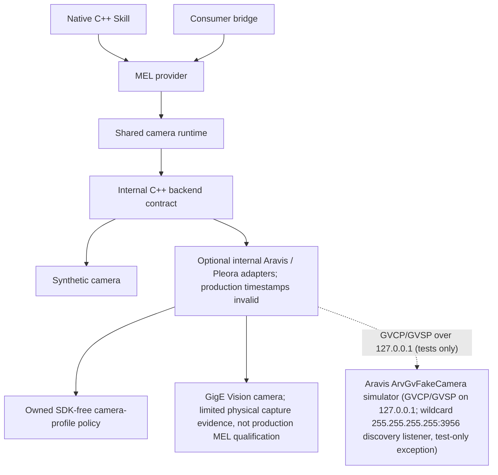
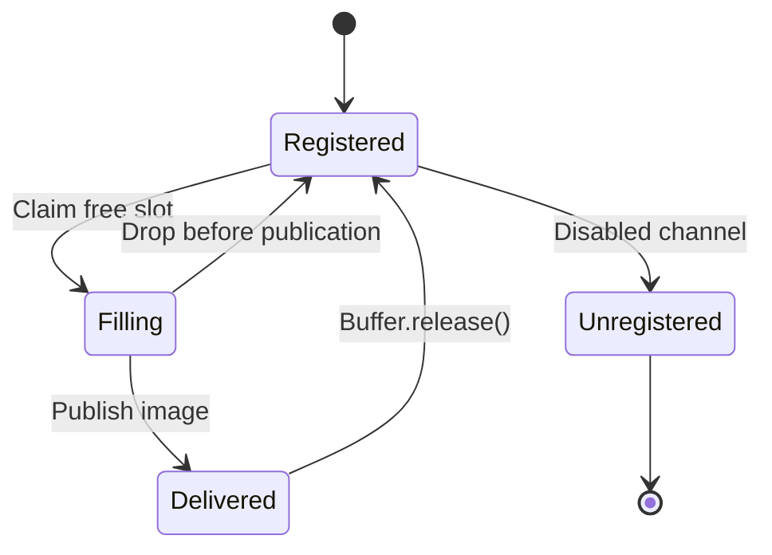

# Architecture and scope

Start with the [documentation index](index.md) and [current capability/evidence
status](status.md). This document describes the native provider boundaries and
lifecycle contracts; the [qualification index](qualification-evidence.md)
links the original experiments and their historical conclusions.
For a new camera model, start with [camera-profile authoring](camera-profile-authoring.md).
For complete MEL implementation requirements, use the
[requirements traceability](mel-traceability.md) and pinned upstream declarations.

GIGE-MEL-038 introduces a separate [controlled GVCP loopback experiment](controlled-gvcp-transport.md),
not a provider dependency or camera service. Its one-send/deadline contract is
independently tested; SDK ownership and sensor navigation integration remain
unqualified. Existing installed interfaces and profile ABI v1 are unchanged.

GIGE-MEL-037 adds an optional [internal register/memory service](device-register-transport.md)
on explicitly opened SDK devices. Whole transactions borrow a service under the
existing native-device mutex; no installed interface, profile v1 ABI or navigation
sink changes. Native retry/deadline limits remain documented open gates.

## Explicit matched-C++ profile modules (GIGE-MEL-035)

An opt-in Linux x86-64 loader now validates separately compiled camera-profile
shared libraries through a versioned C-linkage discovery entry point, then uses
the existing C++ profile interface under an explicitly matched compiler/stdlib/
ABI/interface contract. This is not a stable cross-toolchain C ABI or a runtime
backend plugin API. The installed common provider and exported MEL factories
remain independent and unchanged. No new MEL capability or camera/clock
qualification is claimed.

Module profiles and independently surviving states each retain a host-owned
shared RAII module pin. Plugin objects and shared_ptr deleters retire before the
last pin attempts dlclose. Existing native stream/lease contracts are unchanged;
retired native/copy frame storage remains valid without plugin code. There is no
force unload, hot replacement, implicit search/discovery or fallback. See
[profile authoring](camera-profile-authoring.md),
[runtime loading](runtime-selection.md#explicit-module-loading), and the
[pre-implementation boundary audit](tasks/GIGE-MEL-035-design.md).


GIGE-MEL-034 introduces an internal, SDK-independent source-level camera-profile
interface with owned per-device policy state and explicit injection into Aravis
and Pleora. Selection now executes independently registered implementations,
not just profile IDs. The default monochrome algorithms and historical diagnostic
ID are preserved. No MEL capability, channel, factory, buffer ownership or
production timestamp qualification changes. See [profile authoring and lifetime](camera-profile-authoring.md)
and the [pre-implementation dependency audit](tasks/GIGE-MEL-034-design.md).

## Status

GIGE-MEL-033 adds an explicitly owned SDK-free backend catalog and exact
device/profile binding in a separate, uninstalled composition target. Optional
factories are registered only when built; the provider and shared profile sources
remain unchanged. [Runtime selection](runtime-selection.md) specifies validation,
no-I/O selection, lifecycle and ownership boundaries; explicit matched-C++
profile loading is implemented, while dynamic backend plugins are not.

The optional [Pleora backend](pleora-integration.md) implements the existing
source interfaces using the same SDK-free profile and typed feature service.
Its bounded copy leases retain no SDK objects, so native stop/close do not
invalidate retained pixels. It is uninstalled and default-OFF. Licensed hardware
qualification and production clock qualification remain pending; no provider
factory or MEL advertisement changes.

**GIGE-MEL-023:** [backend-independent navigation forwarding](navigation-backend-forwarding.md)
adds project-owned navigation values and an optional device-side C++ navigation
sink. The existing Image operation prepares acknowledgement before synchronous
submission under the operation lock, then commits only on backend acceptance.
Callbacks remain outside locks and detach drains them. Without a sink the
receipt-only path is unchanged. No navigation transport or image association is
implemented, and no MEL declaration or factory signature changes.

**GIGE-MEL-022:** the shared image path supports default Mono8 and explicitly
selected unpacked Mono12 (12 significant/16 storage bits, one band,
little-endian LSB-aligned words). Format belongs to the backend/device profile,
not CameraCommand. Checked layout arithmetic and minimum final-row spans precede
copies. Aravis requires independent native endianness readback; PFNC alone does
not specify it. [Mono12 profile](mono12-image-profile.md) separates synthetic
and simulated evidence from pending physical Cognex and timestamp qualification.

This repository implements a **native C++ provider of the AMS-GRA IR MEL API**. The default image source is deterministic synthetic. Optional Aravis and Pleora adapters supply real SDK control and source acquisition; production MEL image delivery remains gated by timestamp and camera-profile qualification.

**Current SDK status.** Aravis 0.8.36 and Pleora eBUS Pv 6.5.3.7155 are
optional, internal and uninstalled. Both support discovery, exact device open,
shared camera-profile configuration/readback and bounded source acquisition.
They can be composed through the internal catalog when built, but the exported
`getAPI_Manager` still accepts only `synthetic`. Both adapters return invalid
production timestamps, so their frames are rejected by the common provider.
Positive MEL pixel tests use a test-only virtual integration-start clock.

Aravis Fake and loopback simulator tests, Pleora native GenApi/PvBuffer fixtures,
and limited physical Cognex observations establish different evidence scopes;
see [current status](status.md), [Aravis integration](aravis-integration.md),
[Pleora integration](pleora-integration.md) and the
[physical record](cognex-cic-5000r.md). Aravis loopback clients restrict their
traffic to loopback, but the pinned simulator also binds a wildcard discovery
listener under a documented test-only exception, not network isolation.
Physical capture does not qualify production integration-start time, optics,
UTC/PTP, reliability or full MEL conformance.

The MEL image profile is deliberately narrow: one staring camera, one Image channel,
one band, Mono8 or explicitly admitted unpacked little-endian Mono12, and
consumer-provided host memory. Padded source rows are validated and repacked into
the destination layout. Source-backed stacks and LOS are conditional foundations
with recording-fixture sources only, not default production camera capabilities.
**This is an experimental image-stream implementation, not full MEL 4.0
conformance.** Required methods still report unsupported and channel families
remain unavailable. The [traceability inventory](mel-traceability.md) separates those
gaps from optional enhancements.

The interface snapshots, exact commits, source licenses, and integrity procedure are recorded in [upstream provenance](upstream-provenance.md). Interface version 4.0 describes the upstream contract; it must not be interpreted as this implementation's completeness or product version.

## The product boundary

GIGE-MEL-012 adds a private per-logical-device terminal latch for Aravis's
`ArvDevice::control-lost` heartbeat signal. It is independent of acquisition
ownership, uncertain commands, cancellation and logical closure. No public
backend/provider interface changes or provider-specific SDK branches are added.
The signal handler only stores an atomic; receive and operations translate it
to an explicit terminal backend error. Existing MEL stream-failure diagnostics
apply, and recovery requires explicit close/reopen. The native release order
accounts for GLib's temporary signal-instance reference to avoid heartbeat
self-join; see [the lifecycle contract](aravis-integration.md#confirmed-camera-control-loss-gige-mel-012).
Simulated privilege revocation does not qualify physical disconnect detection.

A Skill calls this repository's MEL implementation. The existing consumer bridge can be another client of that implementation; it does not define the provider's internal architecture.



There are three contracts with different responsibilities:

| Boundary | Responsibility | Compatibility policy |
| --- | --- | --- |
| Skill → MEL provider | Upstream object interfaces, factories, capability reports, request futures, callbacks, and explicit buffer release | Follow the pinned MEL headers exactly; document the implemented profile |
| MEL provider → internal camera backend | Device selection, normalized camera configuration, acquisition, frame metadata, and resource ownership | Project-owned C++ interface; adapters are rebuilt together with the provider |
| SDK adapter → transport implementation | SDK initialization, device access, native feature operations, stream management, and native buffer lifetime | Qualify separately for each pinned SDK and supported camera family |

The second boundary is **not a stable binary plugin ABI**. A virtual C++ interface is appropriate for adapters built with this project. It is not sufficient to promise compiler-independent plugin compatibility. GIGE-MEL-035 adds only the matched-C++ profile-module boundary above, not dynamic backend loading. A stable cross-toolchain plugin ABI remains a separate design decision.

### Installed versus internal interfaces

The install rules in [CMakeLists.txt](../CMakeLists.txt) export
`gige_mel::provider`, `gige_mel::backend` (synthetic implementation) and
`gige_mel::mel_headers` in the `GigeMelProvider` CMake package. They install the
pinned upstream headers and all four project headers in
[`include/gige_mel/`](../include/gige_mel/): `provider.hpp`, `backend.hpp`,
`navigation.hpp` and `line_of_sight.hpp`.

The upstream factories/channels are the MEL consumer-facing interface.
`provider.hpp` offers project source-level embedding and diagnostics;
`backend.hpp` is an SDK/MEL-independent C++ source contract with project-owned
values. Installation does not make these seams a stable binary SDK/plugin ABI.
The common shared provider has no optional vendor SDK dependency.

Camera-profile/feature interfaces in `src/profiles/` and `src/device_features.hpp`,
catalog/session/loader interfaces in `src/selection/`, optional adapter targets
and profile implementations are **uninstalled**. Profile modules use trusted,
explicit matched-build C++ calls after their versioned discovery entry point;
they are not a stable cross-toolchain ABI. See
[profile authoring](camera-profile-authoring.md) and
[selection/loading](runtime-selection.md) for exact matching and lifetime rules.

## Native C++ factory ABI

The first loading path is the upstream manager/control/buffer path:

```cpp
extern "C" std::shared_ptr<API_Manager>
getAPI_Manager(const std::string& instance);

namespace ams::iface::irmel {
extern "C" std::shared_ptr<Control>
getControl(std::string_view instance, std::shared_ptr<::API_Manager> manager);

extern "C" std::shared_ptr<Buffer>
getBuffer(std::string_view instance, std::shared_ptr<::API_Manager> manager);
}
```

The signatures come from the upstream declarations; the export decoration is omitted here only for readability. C linkage makes the exported symbol names discoverable. The parameters and return values are C++ objects, so these are **C++ ABI entry points**, not a callable C API. Consumers and the provider must use compatible compiler, standard library, architecture, runtime, and ABI settings. Exceptions and allocator ownership must not be casually passed between incompatible runtimes. See the pinned [Control][control] and [Buffer][buffer] declarations.

The manager represents one provider context and keeps related objects associated with the selected backend/device. `Control` owns MEL initialization and channel attachment. `Buffer` wraps memory provided by the consumer. Channels translate MEL requests into shared runtime operations and publish MEL data. The bootstrap permits one attached C2 channel and one attached Image channel per manager. The Image channel accepts at most 16 registered host buffers.

`Control::getCapabilities()` is an immutable initial discovery snapshot, which keeps its returned reference stable. `Channel::getCapabilities()` returns the current attached-channel snapshot. After a successful camera command, read the Image channel's capabilities to determine the current image dimensions, pitch, and required destination capacity.

Upstream also has an `IRFactory`/`IRRegistry` path using `create*Channel` symbols. That alternate path is recorded in the roadmap; implementing the manager/control path does not silently implement the registry path. A deployment that uses it must add and test those actual symbols. See [IRFactory][factory].

## What belongs in each layer

### MEL facade

The facade owns MEL-facing semantics:

- Exact overloads, `RequestFor<T>` futures, error conversion, and callback registration rules.
- The relationship between channels and the shared camera state.
- `ChannelCapability` and `FrameHeader` construction.
- Registered host-buffer rules and delivery through `ImageListener::onImage`.
- Explicit unsupported results for unimplemented commands and metadata.

No vendor SDK object belongs in this layer. SDK errors are translated into a project-owned backend error before being mapped to MEL errors.

### Shared runtime

The runtime coordinates all channels that control or observe the same camera. Both the C2 and Image overloads of `send(CameraCommand)` must enter the same configuration path. Otherwise two channels can report success while disagreeing about the camera state.

The runtime also owns stream lifecycle, bounded publication, configuration generations, frame validation, copying or repacking into MEL storage, and teardown ordering. A backend's packet-loss, timeout, or disconnection event must not become an apparently valid image.

The bootstrap uses configuration changes while acquisition is disabled. A future automatic stop/configure/restart operation should remain a shared runtime transaction. It must stop publication, quiesce the native stream, apply changes in the required order, read back the actual configuration, validate destination buffers, advance the generation, and then restart. It must also define what happens if restoration fails after a partial device write.

### Private provider source organization

The common MEL implementation is split into private components under
`src/provider/`. Each manager session still has one shared `Runtime`; channels
use that same state and its existing locks. The split preserves the public
interfaces, advertised capabilities and lifecycle contracts. It introduces no
provider inheritance API or new camera-profile extension interface.

Paths below are relative to `src/`:

| Source | Responsibility |
| --- | --- |
| `provider.cpp`, `factories.cpp` | Manager/session construction, project diagnostics and the existing upstream factory entry points |
| `provider/runtime.hpp/.cpp`, `provider/control.hpp/.cpp` | Shared session state, Control initialization, discovery and channel attachment |
| `provider/channel_core.hpp/.cpp` | Common channel operations, configuration transactions, acquisition lifecycle and callback admission/draining |
| `provider/host_buffer.hpp/.cpp`, `provider/stream_state.hpp`, `provider/frame_delivery.cpp` | Registered host-buffer and acquisition state, validated Image/Stack delivery and frame-header construction |
| `provider/image_channel.cpp`, `provider/stacked_image_channel.cpp`, `provider/c2_channel.cpp`, `provider/health_channel.cpp`, `provider/scheduling_channel.cpp` | Concrete MEL channel implementations and their channel-specific operations |
| `provider/channels.hpp` | Private channel factories that keep concrete channel classes local to their implementations |
| `provider/callback_context.hpp/.cpp` | Shared callback ancestry and submission context for reentry and teardown guards |
| `provider/capabilities.hpp/.cpp`, `provider/results.hpp/.cpp`, `provider/health_snapshot.hpp/.cpp`, `provider/navigation_translation.hpp/.cpp`, `provider/tasking.hpp/.cpp`, `provider/software_identity.hpp` | Focused capability, result, health, navigation, tasking and software-identity helpers |
| `provider/mel_types.hpp`, `provider/unsupported_callbacks.hpp` | Private MEL includes/type aliases and shared unsupported-callback definitions |
| `provider/test_hooks.hpp/.cpp` | Private synchronization hooks enabled only in the dedicated test build |

`callback_context.cpp` owns the thread-local context shared by all provider
components. A callback entered through one channel must remain visible to guards
in another component or manager session on that thread; file boundaries do not
create separate callback contexts.

The production `gige_mel_provider` and uninstalled
`gige_mel_provider_test_seams` targets compile the same
`gige_mel_provider_sources` CMake list. Only the latter defines
`GIGE_MEL_PROVIDER_TEST_SEAMS`; production compiles the
test synchronization points away. The component headers are uninstalled and
remain implementation details, separate from the installed project headers and
the camera-profile/module contracts.

### Multi-stream source ownership

An opened device owns camera acquisition; transport receivers own independent
waits and issue product-tagged leases. A product identifies an image and its
representation/layout, not a transport key or a MEL UUID. Discovery is passive,
and one transport can declare several products. The explicitly constructed
`make_synthetic_multi_stream_backend()` fixture uses one device and two receivers:

```text
synthetic-multi-0 (one device, one acquisition owner)
  +-- transport 0 -> product 100: Mono8  64 x 48 @ 10 Hz
  +-- transport 1 -> product 200: Mono12 80 x 60 @  5 Hz, padded source rows
```

Selected start stages the whole receiver set before committing it. Each source
has its own pool, frame IDs, delivery timing and stream generation. Stop retires
one receiver; last retirement ends camera acquisition. Close wakes all receives
without invalidating held leases. No extra frame copies are needed for routing.
This fixture has fixed per-product configurations and no mutable singleton
configuration view. The existing MEL Image still selects only the legacy
singleton, through a compatibility adapter on native backends. The fixture is
not selected through an exported MEL factory. See the [task design](tasks/GIGE-MEL-MSTREAM-001-design.md)
for SDK sequencing limits, matched-C++ rebuild requirements and the future
product-to-channel mapping.

### SDK adapter and camera profile

An SDK adapter answers “how do I perform this operation with this library?” A camera profile answers “which features, units, constraints, and ordering does this camera model require?” Those concerns should remain separate as real cameras are added.

The internal device interface uses a typed `CameraConfiguration`. GIGE-MEL-024 extracts SDK-free policy into `src/profiles/mono_free_running.hpp/.cpp`, compiled by the internal `gige_mel_camera_profiles` target. GIGE-MEL-025 adds `src/device_features.hpp` and shared orchestration in `mono_free_running_device.hpp/.cpp`: feature aliases, fresh snapshots, configuration write plans and actual readback now use typed, owned values without SDK handles. Pure profile and recording-service tests run in the default build.

The SDK-free synthetic implementation is in
[`src/backends/synthetic/`](../src/backends/synthetic/synthetic_backend.cpp).
The optional adapters have separate backend, typed feature, and stream units
under `src/backends/aravis/` and `src/backends/pleora/`. For Aravis,
[`aravis_backend.cpp`](../src/backends/aravis/aravis_backend.cpp) owns discovery,
device ownership and close; [`aravis_features.cpp`](../src/backends/aravis/aravis_features.cpp)
implements native typed access and SDK error translation, and
[`aravis_stream.cpp`](../src/backends/aravis/aravis_stream.cpp) executes native
runs, decodes buffers and manages leases. The device lock and native lifetime
cover each complete shared transaction. Explicit synchronous guards preserve
connection checks around readback and before each write. Native command-attempt
tracking, acquisition uncertainty, stream cancellation and buffer ownership stay
with the adapter. Aravis pool budgets live in `acquisition_policy.hpp` and are
explicit inputs to common planning. Pleora implements the same feature and
profile contracts with native GenApi access and bounded host-copy acquisition;
see [camera-profile portability](camera-profile-portability.md) and
[Pleora integration](pleora-integration.md). `IDeviceFeatures` remains internal;
the separate owned `ICameraProfile`/state interface and explicit catalog provide
selectable policy implementations without a stable cross-toolchain ABI.

Examples of profile concerns include exposure units, `OffsetX`/`OffsetY` handling, ROI increments, when offsets must be cleared before resizing, whether acquisition must stop, and whether frame-rate controls interact with trigger mode. A generic string-to-string feature bag loses type, availability, range, and unit information; avoid making it the core contract.

### GenTL transport and camera backend

- The transport foundation in [`src/transport/gentl/`](../src/transport/gentl/)
  loads and manages CTI producers. Its low-level consumer API owns native
  system, interface, device, stream and buffer lifetimes and provides port
  operations. It does not implement `ICameraBackend`. The probe option
  `GIGE_MEL_BUILD_GENTL_PROBE` and its fixtures exercise it independently.
- The camera backend in [`src/backends/gentl/`](../src/backends/gentl/)
  implements the common camera backend and device contracts. It uses the
  transport consumer and integrates GenApi readback, camera profile validation
  and exact device selection. The backend remains read-only: `apply()` and
  `create_stream()` are unsupported.
  `GIGE_MEL_BUILD_GENTL_BACKEND` is a separate opt-in; neither layer is installed
  or linked into the default MEL provider or backend catalog.

## Frame and buffer ownership

There are two independent leases:

1. A backend `FrameLease` keeps the SDK or synthetic source image valid while the provider reads it.
2. A delivered MEL `Buffer` keeps a registered destination slot unavailable for overwrite until the consumer explicitly calls `Buffer::release()`.

The bootstrap copies or repacks the source image into the registered destination. The source lease can then end while the destination remains held by the consumer. This is a portable integration path across libraries with different ownership rules. It is not an end-to-end zero-copy claim.



The consumer owns the host allocation passed to `Buffer::init`. That allocation must stay alive while registered and while any delivery still uses it. A `shared_ptr<Buffer>` owns the wrapper, not necessarily the pointed-to allocation. `release()` allows reuse; after calling it, the consumer must stop reading that delivery even if it still retains a shared pointer. Conversely, destroying one shared-pointer copy is not a substitute for the upstream explicit-release operation. These rules follow the [Buffer contract][buffer].

The provider must never allocate an unbounded number of destination images to accommodate a slow consumer. Pool exhaustion prevents new delivery until a slot becomes reusable, or follows an explicitly documented bounded drop policy. It must never overwrite a held slot. Register/unregister operations occur before enable or after disable, as specified by [Channel][channel].

Disabling publication does not invalidate an already-delivered image. Unregistration, reinitialization, and destruction must respect outstanding deliveries. Native-buffer destruction can need to be deferred in a future direct-storage path, even after logical device close.

The consumer must also retain the dynamic library handle until all provider-created objects, callbacks, futures, and outstanding buffers have been released and destroyed. A valid memory allocation does not keep the provider's destructor or vtable code loaded.

## Threads, callbacks, and shutdown

All access to mutable camera configuration is serialized. The acquisition worker waits for a backend image, validates it, claims a free registered destination, copies pixels, constructs a metadata snapshot, and invokes the consumer listener outside provider locks.

Callbacks should be short. Consumers may release the delivered buffer, inspect capabilities and project statistics, use keepalive, and send communications requests with correlated replies. They must queue lifecycle/configuration changes to a control thread and return without waiting for work that could depend on callback completion. Mutating channel/control operations reject calls from any provider callback on the current thread, even one belonging to another provider instance, with the applicable failure/invalid-state/empty-pointer result. Metadata callbacks run synchronously on the submitting thread, outside provider locks. Image callbacks run on the acquisition worker. A nonallocating callback stack preserves the full runtime ancestry across nesting and exceptions; mutation guards use any-callback detection, while defensive teardown uses runtime ancestry. External detach closes metadata admission and drains admitted callbacks before returning. Disabling, detaching, or destroying the active channel from its acquisition callback must never lead to a self-join. The application's supported teardown sequence still destroys the provider graph from a control thread and retains the library handle. Do not broaden the callback contract merely because an ordinary-thread test passes.

Shutdown has two observable stages:

1. **Logical stop:** stop accepting/publishing new work, wake bounded receives, and prevent later SDK callbacks from publishing stale frames.
2. **Physical cleanup:** join workers and release native resources when their outstanding leases permit it.

For the copy path, delivered destination buffers contain independent host bytes. For a future direct path, stream/device/SDK lifetime may need to survive logical stop. No adapter may capture a raw device pointer in a release callback that can run after the device has been destroyed.

Errors raised inside worker or consumer callbacks must not terminate the process or leave the buffer permanently in a filling state. The implementation and tests need a defined callback-failure policy. A long-running user callback is still an external source of stop latency; do not promise a hard real-time shutdown bound without a bounded callback contract.

## Configuration and metadata

C2 ConfigSet and both CameraCommand entry points reuse one internal typed,
callback-free transaction; ConfigSet does not synthesize a public CameraCommand.
Per-request outcomes supply futures and C2 terminal status independently of
global last-error diagnostics. Results are prepared before dispatch; C2
CameraCommand's Image response precedes C2 status. The private SAX parser and
precise schema/status contract are documented in [configuration](configuration.md).

`CameraCommand` is a complete camera request, not a patch object: it has no partial-update mask. Its width, height, offsets, integration time, frame rate, image type, and stage/direction fields must receive an explicit profile interpretation. An unsupported scanning request must not be accepted as if it were a staring request. See [CameraCommand][camera-command].

Controls cover ROI, nanosecond integration time and integer-hertz frame rate for a one-band staring stream. Mono8 and explicitly admitted unpacked Mono12 share the controls; configuration does not switch pixel format. Configuration is validated before mutation. Reconfiguration while enabled is rejected; the caller disables, submits a complete request, checks the result and current Image channel capabilities, makes its registered buffers large enough, and enables again.

`CameraCommandResp::commandSuccess` describes whether all requested parameters are satisfiable. It contains neither a per-field readback nor a detailed failure reason. Detailed backend diagnostics therefore remain in internal errors/logs; do not invent fields in the upstream response. A failed backend request maps to an upstream error result where appropriate. See [CameraCommandResp][camera-response].

Every frame uses the configuration snapshot associated with its acquisition generation. A queued image from generation N cannot be relabeled with generation N+1's ROI or integration time. The bounded copy path validates row stride/span with overflow checks and strips row padding; packed formats and chunk trailers are not part of the admitted image layouts.

`ChannelCapability::bitDepth` is the signal dynamic range; `FrameHeader::bitsPerPixel` is the storage representation. They happen to agree at eight in Mono8. They need not agree for a 12-bit sensor stored in 16-bit words. `rowPitch` is bytes, not pixels. The initial published rows are tightly packed, so the image byte count is `width * height` after checked arithmetic. See [ChannelCapability][capability] and [FrameHeader][frame-header].

### Time is a contract

Backend timestamps carry a unit, clock domain, event meaning, validity, and discontinuity/generation context. A raw camera counter, a host receive timestamp, and an integration-start timestamp are not interchangeable.

For staring imagery, the upstream `FrameHeader::systemTime` comment calls for start of integration. A `std::chrono::nanoseconds` value alone does not identify an epoch. The synthetic source uses a synthetic/host monotonic time basis suitable for tests; it does not establish UTC, PTP synchronization, or physical exposure accuracy. A real adapter must define and qualify the conversion with its camera and intended Skill before claiming temporal interoperability.

The synthetic optical model assigns an angular pixel pitch of 0.001 radians in each direction, yielding `horizontalFOV = width * 0.001` and `verticalFOV = height * 0.001`. This is an explicit test model, not camera calibration. Its navigation/inertial state vectors are empty. Do not reuse these synthetic optics or fabricate navigation/line-of-sight values for a real source.

## Errors and capabilities

### Partial Health snapshots

Health shares the initialized manager/Control lifecycle but has no image
storage. One enabled Health attachment owns an independent, interruptible
100 ms publisher. A state-mutex-protected weak acquisition link exposes the
existing atomic StreamState failure flag without reading ChannelCore's
operation-owned stream pointer. Sampling never takes the operation mutex or
calls backend/device/stream methods. Both reports use the same core snapshot;
atomic counters are independently sampled, not made globally transactional.

Periodic callbacks reuse metadata admission and the thread-local callback guard.
No internal locks cross consumer entry. Disable closes periodic admission and
joins; internal detach (including Control destruction) invokes the same worker
cleanup before metadata draining. Worker state is independent, owner links are
weak, and strong Control/channel pins exist only during preparation/dispatch,
never the wait. Last-owner destruction on the worker uses self-thread-safe
teardown. Image ownership and retained bytes are unaffected by Health shutdown.
See [Health status](health-status.md) for exact state mapping, vocabulary,
exception/reentry policy, observation limits and public consumer demonstration.

The internal backend may distinguish timeout, disconnected, invalid state, unsupported, resource exhaustion, and I/O failures. MEL translation must use actual upstream values. Common MEL `ErrorCode` has no dedicated timeout enumerator; preserve the reason in the error description and choose an existing code by documented policy. IR `Return` provides `Success`, `BadPointer`, `Fail`, `NotSupported`, and `NotImplemented`; it is not the same error type as the future's `ErrorOr` result.

A channel reports only capabilities that the selected camera, selected backend, and implemented MEL profile jointly support. Presence of a GenApi feature name does not prove it is currently available, writable, or implemented as a MEL operation. Never advertise a callback solely because a pure virtual method was filled in with a stub. The selected camera can offer more than another backend's camera; do not reduce all adapters to the intersection of all possible SDKs.

## Extension sequence

The common runtime now also owns the bounded [software BIT profile](software-bit.md):
one latest immutable completion and two current-fault observation timestamps under
the state mutex. C2 executes the fixed observed-state check without device I/O;
Health captures its retained completion/current faults with the same state used
for existing reports. BIT adds no worker, backend interface or factory signature.
Registration/command dispatch pins owners and enters consumers outside locks.
Health remains weak across waits and retains the R1 acquisition unpublication rule.

The [software subsystem profile](subsystem-status.md) extends that same
`health_snapshot()` transaction under the state mutex. It commits a
manager-lifetime BIT-state revision together with the completion/fault
observations whenever their committed semantic state changes. When a
SubsystemStatusResp is registered, it also derives a fixed software
subsystem/CSCI report from the captured core state and consumes a separate
prepared-report sequence. The batch carries both values from capture to
dispatch (MFA_Status, Detailed, BIT_Status, SubsystemStatusResp) without
rereading the runtime. It adds no worker, backend call, public ABI or
factory change.

Current development gates are:

1. Keep native MEL loading, memory ownership, and synthetic lifecycle tests green.
2. Close remaining required C2, Image, Health and mission-channel gaps with real sources and explicit semantics; existing bounded software/recording profiles do not close the full contract.
3. Qualify production integration-start time, optics and physical lifecycle/failure behavior for a selected SDK/camera combination. Existing Aravis/Pleora source capture is not production MEL qualification. The [backend portability](backend-portability.md) suite remains synthetic plus an independent test-only fixture, not physical-camera proof.
4. Extend shared scenarios and independent SDK/camera evidence without weakening lease, callback or configuration contracts. Two SDK adapters now exist; further implementation alone does not resolve qualification gates.
5. Add format/time features and direct registered-storage acquisition only after their qualification criteria are satisfied.

Detailed implementation gates are in [the roadmap](mel-surface-roadmap.md), and the adapter contract is in [backend authoring](backend-authoring.md).

[control]: https://github.com/open-arsenal/ams-gra-hello-world-sk-interfaces-ir-mel/blob/8d9224519f12b44e0b28815755c56a32a28d24a0/include/irmel/library/irmel-types/Control.h
[buffer]: https://github.com/open-arsenal/ams-gra-hello-world-sk-interfaces-ir-mel/blob/8d9224519f12b44e0b28815755c56a32a28d24a0/include/irmel/library/irmel-types/Buffer.h
[channel]: https://github.com/open-arsenal/ams-gra-hello-world-sk-interfaces-ir-mel/blob/8d9224519f12b44e0b28815755c56a32a28d24a0/include/irmel/library/irmel-types/Channel.h
[factory]: https://github.com/open-arsenal/ams-gra-hello-world-sk-interfaces-ir-mel/blob/8d9224519f12b44e0b28815755c56a32a28d24a0/include/irmel/library/factory/IRFactory.h
[camera-command]: https://github.com/open-arsenal/ams-gra-hello-world-sk-interfaces-ir-mel/blob/8d9224519f12b44e0b28815755c56a32a28d24a0/include/irmel/library/irmel-types/CameraCommand.h
[camera-response]: https://github.com/open-arsenal/ams-gra-hello-world-sk-interfaces-ir-mel/blob/8d9224519f12b44e0b28815755c56a32a28d24a0/include/irmel/library/irmel-types/CameraCommandResp.h
[capability]: https://github.com/open-arsenal/ams-gra-hello-world-sk-interfaces-ir-mel/blob/8d9224519f12b44e0b28815755c56a32a28d24a0/include/irmel/library/irmel-types/ChannelCapability.h
[frame-header]: https://github.com/open-arsenal/ams-gra-hello-world-sk-interfaces-ir-mel/blob/8d9224519f12b44e0b28815755c56a32a28d24a0/include/irmel/library/irmel-types/FrameHeader.h
