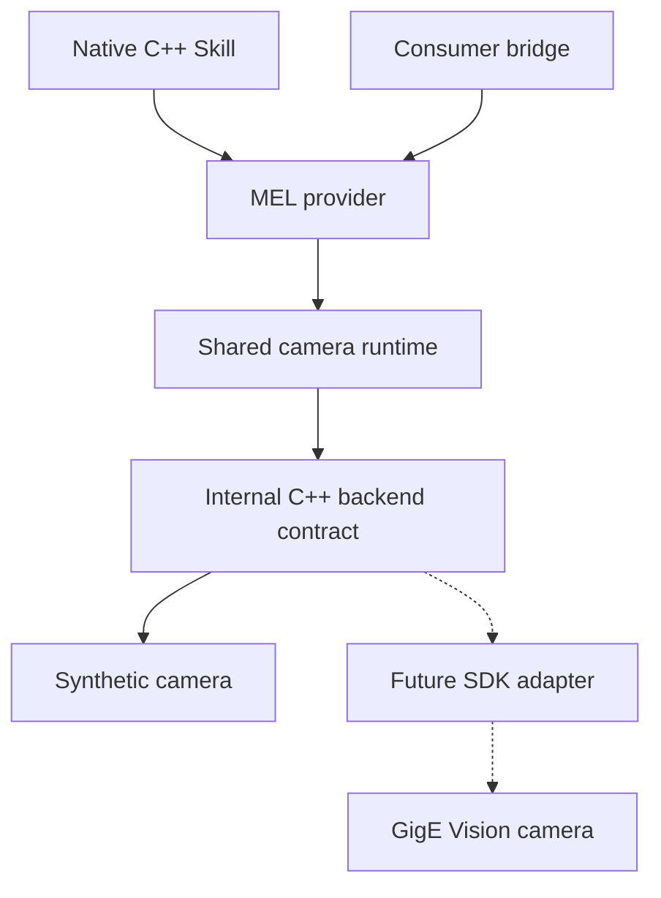
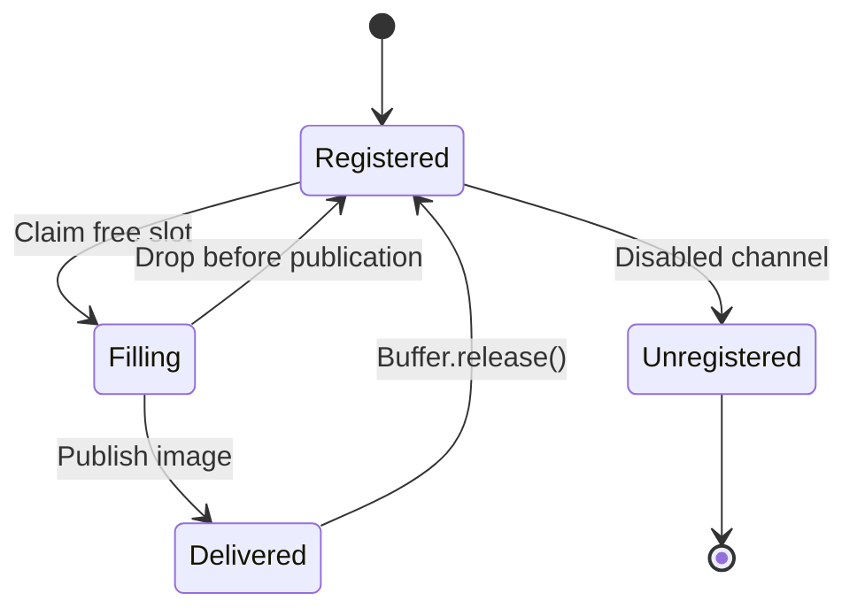

# Architecture and scope

## Status

This repository bootstraps a **native C++ provider of the AMS-GRA IR MEL API**. Its first image source is a deterministic synthetic camera. A real GigE Vision transport implementation is a subsequent adapter, selected after its SDK, license, platforms, and camera have been qualified.

The initial profile is deliberately narrow: one staring camera, one image stream, one band, Mono8 pixels, tightly packed rows, and consumer-provided host memory. The provider exposes selected operations through the pinned MEL 4.0 C++ interfaces. **This is an experimental image-stream bootstrap, not a claim of full MEL 4.0 conformance.** Several members marked required by upstream still report unsupported, and additional channel families remain unavailable. The [surface roadmap](mel-surface-roadmap.md) separates those gaps from optional enhancements.

The interface snapshots, exact commits, source licenses, and integrity procedure are recorded in [upstream provenance](upstream-provenance.md). Interface version 4.0 describes the upstream contract; it must not be interpreted as this implementation's completeness or product version.

## The product boundary

A Skill calls this repository's MEL implementation. The existing consumer bridge can be another client of that implementation; it does not define the provider's internal architecture.



There are three contracts with different responsibilities:

| Boundary | Responsibility | Compatibility policy |
| --- | --- | --- |
| Skill → MEL provider | Upstream object interfaces, factories, capability reports, request futures, callbacks, and explicit buffer release | Follow the pinned MEL headers exactly; document the implemented profile |
| MEL provider → internal camera backend | Device selection, normalized camera configuration, acquisition, frame metadata, and resource ownership | Project-owned C++ interface; adapters are rebuilt together with the provider |
| SDK adapter → transport implementation | SDK initialization, device access, native feature operations, stream management, and native buffer lifetime | Qualify separately for each pinned SDK and supported camera family |

The second boundary is **not a stable binary plugin ABI**. A virtual C++ interface is appropriate for adapters built with this project. It is not sufficient to promise compiler-independent plugin compatibility. A separately versioned plugin ABI would be a future design decision justified by a deployment requirement.

## Native C++ factory ABI

The first loading path is the upstream manager/control/buffer path:

```cpp
extern "C" std::shared_ptr<API_Manager>
getAPI_Manager(const std::string& instance);

namespace ams::iface::irmel {
extern "C" std::shared_ptr<Control>
getControl(std::string_view instance, std::shared_ptr<::API_Manager> manager);

extern "C" std::shared_ptr<Buffer>
getBuffer(std::string_view instance, std::shared_ptr<::API_Manager> manager);
}
```

The signatures come from the upstream declarations; the export decoration is omitted here only for readability. C linkage makes the exported symbol names discoverable. The parameters and return values are C++ objects, so these are **C++ ABI entry points**, not a callable C API. Consumers and the provider must use compatible compiler, standard library, architecture, runtime, and ABI settings. Exceptions and allocator ownership must not be casually passed between incompatible runtimes. See the pinned [Control][control] and [Buffer][buffer] declarations.

The manager represents one provider context and keeps related objects associated with the selected backend/device. `Control` owns MEL initialization and channel attachment. `Buffer` wraps memory provided by the consumer. Channels translate MEL requests into shared runtime operations and publish MEL data. The bootstrap permits one attached C2 channel and one attached Image channel per manager. The Image channel accepts at most 16 registered host buffers.

`Control::getCapabilities()` is an immutable initial discovery snapshot, which keeps its returned reference stable. `Channel::getCapabilities()` returns the current attached-channel snapshot. After a successful camera command, read the Image channel's capabilities to determine the current image dimensions, pitch, and required destination capacity.

Upstream also has an `IRFactory`/`IRRegistry` path using `create*Channel` symbols. That alternate path is recorded in the roadmap; implementing the manager/control path does not silently implement the registry path. A deployment that uses it must add and test those actual symbols. See [IRFactory][factory].

## What belongs in each layer

### MEL facade

The facade owns MEL-facing semantics:

- Exact overloads, `RequestFor<T>` futures, error conversion, and callback registration rules.
- The relationship between channels and the shared camera state.
- `ChannelCapability` and `FrameHeader` construction.
- Registered host-buffer rules and delivery through `ImageListener::onImage`.
- Explicit unsupported results for unimplemented commands and metadata.

No vendor SDK object belongs in this layer. SDK errors are translated into a project-owned backend error before being mapped to MEL errors.

### Shared runtime

The runtime coordinates all channels that control or observe the same camera. Both the C2 and Image overloads of `send(CameraCommand)` must enter the same configuration path. Otherwise two channels can report success while disagreeing about the camera state.

The runtime also owns stream lifecycle, bounded publication, configuration generations, frame validation, copying or repacking into MEL storage, and teardown ordering. A backend's packet-loss, timeout, or disconnection event must not become an apparently valid image.

The bootstrap uses configuration changes while acquisition is disabled. A future automatic stop/configure/restart operation should remain a shared runtime transaction. It must stop publication, quiesce the native stream, apply changes in the required order, read back the actual configuration, validate destination buffers, advance the generation, and then restart. It must also define what happens if restoration fails after a partial device write.

### SDK adapter and camera profile

An SDK adapter answers “how do I perform this operation with this library?” A camera profile answers “which features, units, constraints, and ordering does this camera model require?” Those concerns should remain separate as real cameras are added.

The initial internal interface is a typed `CameraConfiguration`; it does not yet expose a general GenApi node tree or a profile plugin. This keeps the bootstrap small. The first real adapter can factor a profile helper underneath `ICameraDevice::apply` without changing MEL clients. Introduce a generic typed feature interface only when the first two implementations establish what is actually shared.

Examples of profile concerns include exposure units, `OffsetX`/`OffsetY` handling, ROI increments, when offsets must be cleared before resizing, whether acquisition must stop, and whether frame-rate controls interact with trigger mode. A generic string-to-string feature bag loses type, availability, range, and unit information; avoid making it the core contract.

## Frame and buffer ownership

There are two independent leases:

1. A backend `FrameLease` keeps the SDK or synthetic source image valid while the provider reads it.
2. A delivered MEL `Buffer` keeps a registered destination slot unavailable for overwrite until the consumer explicitly calls `Buffer::release()`.

The bootstrap copies or repacks the source image into the registered destination. The source lease can then end while the destination remains held by the consumer. This is a portable integration path across libraries with different ownership rules. It is not an end-to-end zero-copy claim.



The consumer owns the host allocation passed to `Buffer::init`. That allocation must stay alive while registered and while any delivery still uses it. A `shared_ptr<Buffer>` owns the wrapper, not necessarily the pointed-to allocation. `release()` allows reuse; after calling it, the consumer must stop reading that delivery even if it still retains a shared pointer. Conversely, destroying one shared-pointer copy is not a substitute for the upstream explicit-release operation. These rules follow the [Buffer contract][buffer].

The provider must never allocate an unbounded number of destination images to accommodate a slow consumer. Pool exhaustion prevents new delivery until a slot becomes reusable, or follows an explicitly documented bounded drop policy. It must never overwrite a held slot. Register/unregister operations occur before enable or after disable, as specified by [Channel][channel].

Disabling publication does not invalidate an already-delivered image. Unregistration, reinitialization, and destruction must respect outstanding deliveries. Native-buffer destruction can need to be deferred in a future direct-storage path, even after logical device close.

The consumer must also retain the dynamic library handle until all provider-created objects, callbacks, futures, and outstanding buffers have been released and destroyed. A valid memory allocation does not keep the provider's destructor or vtable code loaded.

## Threads, callbacks, and shutdown

All access to mutable camera configuration is serialized. The acquisition worker waits for a backend image, validates it, claims a free registered destination, copies pixels, constructs a metadata snapshot, and invokes the consumer listener outside provider locks.

Callbacks should be short. Consumers may release the delivered buffer, inspect capabilities and project statistics, use keepalive, and send communications requests with correlated replies. They must queue lifecycle/configuration changes to a control thread and return without waiting for work that could depend on callback completion. Mutating channel/control operations reject calls from any provider callback on the current thread, even one belonging to another provider instance, with the applicable failure/invalid-state/empty-pointer result. Metadata callbacks run synchronously on the submitting thread, outside provider locks. Image callbacks run on the acquisition worker. A nonallocating callback stack preserves the full runtime ancestry across nesting and exceptions; mutation guards use any-callback detection, while defensive teardown uses runtime ancestry. External detach closes metadata admission and drains admitted callbacks before returning. Disabling, detaching, or destroying the active channel from its acquisition callback must never lead to a self-join. The application's supported teardown sequence still destroys the provider graph from a control thread and retains the library handle. Do not broaden the callback contract merely because an ordinary-thread test passes.

Shutdown has two observable stages:

1. **Logical stop:** stop accepting/publishing new work, wake bounded receives, and prevent later SDK callbacks from publishing stale frames.
2. **Physical cleanup:** join workers and release native resources when their outstanding leases permit it.

For the copy path, delivered destination buffers contain independent host bytes. For a future direct path, stream/device/SDK lifetime may need to survive logical stop. No adapter may capture a raw device pointer in a release callback that can run after the device has been destroyed.

Errors raised inside worker or consumer callbacks must not terminate the process or leave the buffer permanently in a filling state. The implementation and tests need a defined callback-failure policy. A long-running user callback is still an external source of stop latency; do not promise a hard real-time shutdown bound without a bounded callback contract.

## Configuration and metadata

C2 ConfigSet and both CameraCommand entry points reuse one internal typed,
callback-free transaction; ConfigSet does not synthesize a public CameraCommand.
Per-request outcomes supply futures and C2 terminal status independently of
global last-error diagnostics. Results are prepared before dispatch; C2
CameraCommand's Image response precedes C2 status. The private SAX parser and
precise schema/status contract are documented in [configuration](configuration.md).

`CameraCommand` is a complete camera request, not a patch object: it has no partial-update mask. Its width, height, offsets, integration time, frame rate, image type, and stage/direction fields must receive an explicit profile interpretation. An unsupported scanning request must not be accepted as if it were a staring request. See [CameraCommand][camera-command].

For the initial profile, controls cover ROI, nanosecond integration time, and integer hertz frame rate for one staring Mono8 stream. Configuration is validated before mutation. Reconfiguration while enabled is rejected; the caller disables, submits a complete request, checks the result and current Image channel capabilities, makes its registered buffers large enough, and enables again.

`CameraCommandResp::commandSuccess` describes whether all requested parameters are satisfiable. It contains neither a per-field readback nor a detailed failure reason. Detailed backend diagnostics therefore remain in internal errors/logs; do not invent fields in the upstream response. A failed backend request maps to an upstream error result where appropriate. See [CameraCommandResp][camera-response].

Every frame uses the configuration snapshot associated with its acquisition generation. A queued image from generation N cannot be relabeled with generation N+1's ROI or integration time. Once source layouts include row padding, chunk trailers, or packed pixels, the runtime must validate sizes with overflow checks and copy only valid image data.

`ChannelCapability::bitDepth` is the signal dynamic range; `FrameHeader::bitsPerPixel` is the storage representation. They happen to agree at eight in Mono8. They need not agree for a 12-bit sensor stored in 16-bit words. `rowPitch` is bytes, not pixels. The initial published rows are tightly packed, so the image byte count is `width * height` after checked arithmetic. See [ChannelCapability][capability] and [FrameHeader][frame-header].

### Time is a contract

Backend timestamps carry a unit, clock domain, event meaning, validity, and discontinuity/generation context. A raw camera counter, a host receive timestamp, and an integration-start timestamp are not interchangeable.

For staring imagery, the upstream `FrameHeader::systemTime` comment calls for start of integration. A `std::chrono::nanoseconds` value alone does not identify an epoch. The synthetic source uses a synthetic/host monotonic time basis suitable for tests; it does not establish UTC, PTP synchronization, or physical exposure accuracy. A real adapter must define and qualify the conversion with its camera and intended Skill before claiming temporal interoperability.

The synthetic optical model assigns an angular pixel pitch of 0.001 radians in each direction, yielding `horizontalFOV = width * 0.001` and `verticalFOV = height * 0.001`. This is an explicit test model, not camera calibration. Its navigation/inertial state vectors are empty. Do not reuse these synthetic optics or fabricate navigation/line-of-sight values for a real source.

## Errors and capabilities

### Partial Health snapshots

Health shares the initialized manager/Control lifecycle but has no image
storage. One enabled Health attachment owns an independent, interruptible
100 ms publisher. A state-mutex-protected weak acquisition link exposes the
existing atomic StreamState failure flag without reading ChannelCore's
operation-owned stream pointer. Sampling never takes the operation mutex or
calls backend/device/stream methods. Both reports use the same core snapshot;
atomic counters are independently sampled, not made globally transactional.

Periodic callbacks reuse metadata admission and the thread-local callback guard.
No internal locks cross consumer entry. Disable closes periodic admission and
joins; internal detach (including Control destruction) invokes the same worker
cleanup before metadata draining. Worker state is independent, owner links are
weak, and strong Control/channel pins exist only during preparation/dispatch,
never the wait. Last-owner destruction on the worker uses self-thread-safe
teardown. Image ownership and retained bytes are unaffected by Health shutdown.
See [Health status](health-status.md) for exact state mapping, vocabulary,
exception/reentry policy, observation limits and public consumer demonstration.

The internal backend may distinguish timeout, disconnected, invalid state, unsupported, resource exhaustion, and I/O failures. MEL translation must use actual upstream values. Common MEL `ErrorCode` has no dedicated timeout enumerator; preserve the reason in the error description and choose an existing code by documented policy. IR `Return` provides `Success`, `BadPointer`, `Fail`, `NotSupported`, and `NotImplemented`; it is not the same error type as the future's `ErrorOr` result.

A channel reports only capabilities that the selected camera, selected backend, and implemented MEL profile jointly support. Presence of a GenApi feature name does not prove it is currently available, writable, or implemented as a MEL operation. Never advertise a callback solely because a pure virtual method was filled in with a stub. The selected camera can offer more than another backend's camera; do not reduce all adapters to the intersection of all possible SDKs.

## Extension sequence

The common runtime now also owns the bounded [software BIT profile](software-bit.md):
one latest immutable completion and two current-fault observation timestamps under
the state mutex. C2 executes the fixed observed-state check without device I/O;
Health captures its retained completion/current faults with the same state used
for existing reports. BIT adds no worker, backend interface or factory signature.
Registration/command dispatch pins owners and enters consumers outside locks.
Health remains weak across waits and retains the R1 acquisition unpublication rule.

The [software subsystem profile](subsystem-status.md) extends that same
`health_snapshot()` transaction under the state mutex. It commits a
manager-lifetime BIT-state revision together with the completion/fault
observations whenever their committed semantic state changes. When a
SubsystemStatusResp is registered, it also derives a fixed software
subsystem/CSCI report from the captured core state and consumes a separate
prepared-report sequence. The batch carries both values from capture to
dispatch (MFA_Status, Detailed, BIT_Status, SubsystemStatusResp) without
rereading the runtime. It adds no worker, backend call, public ABI or
factory change.

The next development sequence is:

1. Keep native MEL loading, memory ownership, and synthetic lifecycle tests green.
2. Add the required operational C2, Image metadata/navigation, and Health surfaces with an explicit sensor/profile interpretation.
3. Implement one real SDK adapter and camera profile using the portable copy path.
4. Add a second narrow SDK adapter to test whether the internal contract is genuinely reusable.
5. Add format/time features and direct registered-storage acquisition only after their qualification criteria are satisfied.

Detailed implementation gates are in [the roadmap](mel-surface-roadmap.md), and the adapter contract is in [backend authoring](backend-authoring.md).

[control]: https://github.com/open-arsenal/ams-gra-hello-world-sk-interfaces-ir-mel/blob/8d9224519f12b44e0b28815755c56a32a28d24a0/include/irmel/library/irmel-types/Control.h
[buffer]: https://github.com/open-arsenal/ams-gra-hello-world-sk-interfaces-ir-mel/blob/8d9224519f12b44e0b28815755c56a32a28d24a0/include/irmel/library/irmel-types/Buffer.h
[channel]: https://github.com/open-arsenal/ams-gra-hello-world-sk-interfaces-ir-mel/blob/8d9224519f12b44e0b28815755c56a32a28d24a0/include/irmel/library/irmel-types/Channel.h
[factory]: https://github.com/open-arsenal/ams-gra-hello-world-sk-interfaces-ir-mel/blob/8d9224519f12b44e0b28815755c56a32a28d24a0/include/irmel/library/factory/IRFactory.h
[camera-command]: https://github.com/open-arsenal/ams-gra-hello-world-sk-interfaces-ir-mel/blob/8d9224519f12b44e0b28815755c56a32a28d24a0/include/irmel/library/irmel-types/CameraCommand.h
[camera-response]: https://github.com/open-arsenal/ams-gra-hello-world-sk-interfaces-ir-mel/blob/8d9224519f12b44e0b28815755c56a32a28d24a0/include/irmel/library/irmel-types/CameraCommandResp.h
[capability]: https://github.com/open-arsenal/ams-gra-hello-world-sk-interfaces-ir-mel/blob/8d9224519f12b44e0b28815755c56a32a28d24a0/include/irmel/library/irmel-types/ChannelCapability.h
[frame-header]: https://github.com/open-arsenal/ams-gra-hello-world-sk-interfaces-ir-mel/blob/8d9224519f12b44e0b28815755c56a32a28d24a0/include/irmel/library/irmel-types/FrameHeader.h
