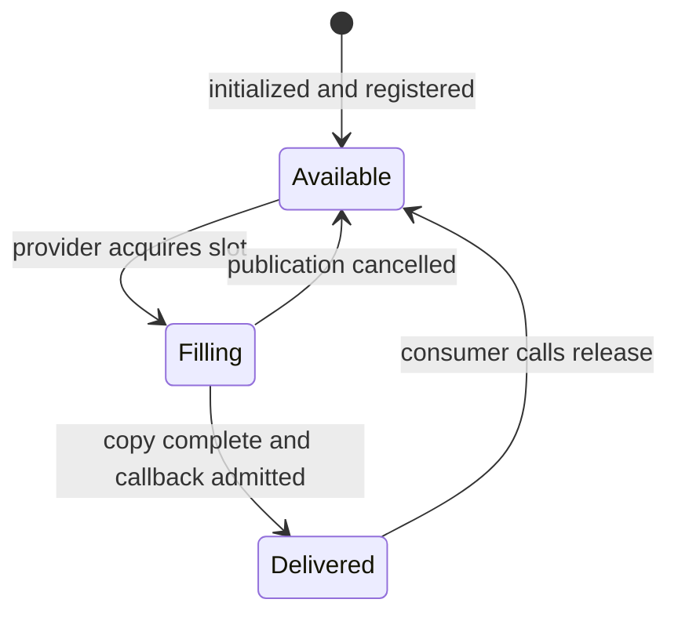

# Experimental image-stream profile, version 0.1

This document is the contract implemented by the bootstrap. It describes a
useful development subset against the pinned IR/Common MEL 4.0 declarations.
It is **not full MEL conformance**. Required functionality outside this subset
remains explicitly unsupported; see [the complete inventory](mel-surface-roadmap.md).

## Provider and discovery

The standard factory instance is exactly `synthetic`; unknown names return null.
`getAPI_Manager(instance)` creates an independent manager. `getControl` reuses
the live Control for that manager; a mismatched instance, foreign manager, or
null manager is rejected. `getBuffer` creates an uninitialized buffer associated
with the manager's identity.

`Control::init("")` and `init("mono8-bootstrap")` open `synthetic-0`; repeated
initialization is successful. Other aperture profile names return NotSupported.
Initialize on a control thread before sharing the discovery capability reference.

Three discovery entries are returned: `IRSTImage`, `CommandAndControl`, and
`HealthAndStatus`. The partial Health surface and its state/sampling semantics
are specified in [Health status](health-status.md).
Use the advertised UUID and channel type in `Config`; invented IDs are rejected.
There may be one attached channel of each type per manager. Image attachment
requires a non-null listener. IDs are local to the manager and are not globally
unique multi-camera identity assignments.

`Control::getCapabilities()` is an immutable initialization snapshot. After a
camera configuration change, use **`channel->getCapabilities()`** for current
width, height, row pitch, and buffer requirements. The bootstrap reports API
version 4 and library version 1 in the numeric VersionInfo fields; the detailed
description identifies project version 0.1.0 and its partial profile. This is
a local numeric convention, not a claim of a standardized version packing.

## Image layout and synthetic camera

| Property | Behavior |
| --- | --- |
| Initial image | 64×48 pixels, offsets (0,0) |
| Sensor bounds | 640×480 pixels; positive ROI dimensions, unit increments |
| Pixel format | Mono8, one band, one byte per pixel |
| Registered image layout | Tightly packed row-major bytes; row pitch equals width |
| Backend payload | May have row padding; provider copies each image row into the packed destination |
| Initial rate/exposure | 30 Hz and 1 ms |
| Accepted rate | Integer 1–120 Hz |
| Exposure | Positive nanoseconds, no longer than one frame period |
| Native pool | Four frame slots by default, retained until backend leases are destroyed |
| Registered MEL slots | At least one to enable; maximum 16 by default |
| Pixel pattern | `(x + y + native_frame_id) & 255`, with x/y local to the ROI |
| Native IDs | Monotonic within the synthetic device lifetime; MEL exposes low 32 bits |
| Subframe metadata | ID 0, total 1; staring snapshot, no image flip |
| Synthetic optics | Linear angular pitch of 0.001 radians/pixel on each axis; FOV equals ROI dimension times pitch |
| Navigation/calibration | Empty navigation state, no advertised calibrated LOS, NUC, distortion map, or spectral characterization |

The synthetic optics are a defined virtual model, not real sensor calibration.
An injected hardware adapter must supply an appropriate characterized profile;
it must not inherit the virtual optics as if they describe a physical camera.

Frames are rejected when their layout, completion status, configuration
snapshot/generation, stream generation, or timestamp contract does not match.
An invalid first frame cannot establish the accepted stream generation. A clock
generation change or backward time within a stream stops acquisition and records
a diagnostic. Disable, resolve the mapping, and start a new stream to recover.

## Time conventions

The synthetic frame timestamp is a host steady-clock value in nanoseconds,
representing virtual integration start. It has no UTC or TAI epoch and no PTP
accuracy claim. `FrameHeader::integrationTime` is the actual configuration
snapshot's exposure. Command response timestamps use the same host steady-clock
domain to describe response time, rather than echoing a caller timestamp.

An injected backend uses `ProviderSettings::timestamp_domain` to select its
declared domain; the provider accepts only valid integration-start timestamps
in that domain. The initial MEL fields carry no general clock-domain/validity
mask. A physical deployment therefore needs an agreed time mapping before it
can interpret `FrameHeader::systemTime` across sensors or processes.

## Registered host memory and release

Create buffers through this manager's `getBuffer`, initialize them with stable
caller allocations, and register them on the disabled Image channel. The memory
belongs to the consumer throughout; a shared Buffer object does not own or pin
the allocation supplied through `init`.

Null, zero-size, too-small, overflowing-address-range, foreign-manager, duplicate,
and overlapping registrations are rejected. Only exactly the Host flag is
supported. GPU/RDMA flags are rejected at registration. Flags default to Host;
void flag mutators only take effect while the buffer is unregistered and idle.
Initialization cannot replace the address while registered, filling, or held.

The slot lifecycle is:

The Image listener receives the registered buffer and a per-frame header.
Consumers may retain either object, but the header reference itself is valid
only during the callback: copy it when retaining metadata. Call `Buffer::release`
exactly once when done reading the image; after success the bytes may change
immediately. Multiple readers must coordinate that one release. An immediate
second release fails; the interface has no per-delivery release token, so a stale
handle must never release a slot that has since been delivered again.

When all MEL slots are held, the provider drops newly received frames and
increments `dropped_no_buffer`; it never grows an unbounded queue or overwrites
a held slot. Releasing a slot permits later frames to resume.

`disable()` preserves registered slots and outstanding bytes. Unregistering a
held slot fails. Re-enabling requires all registered slots to be released and
large enough for the current layout. Detach stops acquisition and unbinds slots;
held bytes remain readable and `release` remains valid after detach, provided
the consumer still owns the raw allocation and keeps provider code loaded.

This is a backend-to-MEL copy path. A downstream consumer may borrow the
registered bytes without another copy; this does not imply end-to-end zero-copy
camera acquisition.

## Camera command semantics

C2 also implements versioned `ConfigSetCommand` and terminal `CommandStatus` for
C2 ConfigSet and CameraCommand. The exact provider-defined schema, working payload,
future/reason mapping, partial-failure rules and callback scope are specified in
[configuration and status](configuration.md). No other C2 command status scope,
command history, update/delete protocol, or duplicate-ID cache is implemented.

Both C2 and Image commands enter the same serialized runtime. Every
`CameraCommand` is a **complete snapshot**, with explicit dimensions, offsets,
rate, integration time, `ImageType::Staring`, and zero TDI stages. Zero dimensions,
rate, or exposure do not mean "leave unchanged." The scanning direction field
has no effect in staring mode; scan/TDI requests are rejected. `systemTime` is
caller correlation/context only; scheduled execution is not implemented.

Image acquisition must be disabled before configuration. A command while the
Image channel is enabled, after detach, or from a provider callback returns a
ready future containing `ErrorCode::InvalidState`.

Unsatisfiable fields produce a correlated `CameraCommandResp` with
`commandSuccess=false`; valid requests with exact readback produce true. A
backend transport/state/resource failure produces an error result. After every
attempted backend apply, configuration is queried again: actual readback is
retained even after a partial failure. Failed readback prevents re-enable. The
synthetic adapter validates atomically, so rejected synthetic requests preserve
the previous configuration.

Responses are immediately ready futures. Registered Image
`CameraCommandResp` metadata is emitted for completed response objects submitted
through **either** C2 or Image. Error-only results do not fabricate a response.
`CameraCommandResp::size` remains zero because no portable wire encoding is
defined here; it is not set to the C++ `sizeof` of the object.

The supported reconfiguration sequence is:

1. Disable the Image channel and wait for the call to return.
2. Finish using and release outstanding image buffers.
3. Send a complete camera command and inspect the future and `commandSuccess`.
4. Query the Image channel's current capabilities.
5. If necessary, unregister old buffers, create/initialize sufficiently large
   allocations, and register their buffers.
6. Enable acquisition again.

Automatic live stop/apply/reallocate/restart, fractional rates, gain, trigger,
pixel-format selection, and camera feature trees are future work. MEL's current
CameraCommand has no fields for several of those settings; a future provider
schema extension must define their control path explicitly.

## Callbacks, threads, and shutdown

Image callbacks run on one provider receive worker per active Image channel.
Communications, camera-response and C2 command-status metadata callbacks run synchronously on the
submitting thread before `send` returns. They are invoked outside the runtime
operation and state locks. The same consumer may receive metadata and image
callbacks concurrently and must synchronize its own state.

The first non-empty callback registration succeeds; an empty callback returns
BadPointer and a duplicate returns Fail. Unsupported callback types return
NotSupported and are absent from metadata capabilities. There is no invented
unregister-callback overload.

Inside an Image callback or synchronous metadata callback, releasing the
delivered buffer, reading capabilities, reading project statistics, keep-alive,
and communications requests with their correlated replies remain supported.
Lifecycle and configuration mutations are rejected from **any provider callback
on the current thread**, including callbacks of another provider instance and
nested callbacks. This includes enable/disable, buffer registration and
unregistration, supported metadata callback registration, camera configuration,
Control initialization, channel attachment/detachment, and Control lookup/creation.
The existing API failure forms apply: Fail, InvalidState for camera requests,
or an empty shared pointer for pointer-returning operations. Unsupported surfaces
remain unsupported.

Queue lifecycle and configuration work onto a separate control thread and return
from the callback. A callback must not synchronously wait for queued work that
could itself depend on callback completion. Callbacks must return in bounded
time; a blocking callback can delay external stop.

Normal external disable joins the worker, so no Image callback remains running
when it returns. External detach closes metadata admission and drains all admitted
metadata callbacks before returning, including callbacks enclosing nested calls
to other providers. Destroying the Control detaches its channels. Defensive
ownership guards handle the last external Control reference disappearing during
an Image callback without self-join or a join/operation-lock deadlock, but
applications should perform destruction outside callbacks and retain a control
handle until orderly shutdown is complete.

An Image callback exception stops the stream, records a failure, and preserves
any delivered buffer until explicit release. A metadata callback exception is
counted and contained; its ready command future remains available. Re-enabling
a faulted still-enabled stream fails; explicitly disable and resolve/release the
outstanding state first. The provider does not silently restart a failed camera.

Unexpected backend receive termination, including `ErrorCode::stopped` without
provider cancellation, records a stream fault and ends reception. Cancellation
observed when the worker handles the failed receive is the ordering point:
already-observed cancellation is normal shutdown; a fault processed first remains
a fault even if disable follows. Receive timeouts without cancellation are
transient and do not count as terminal stream failures.

A faulted acquisition retains logical ownership: repeated `enable()` fails
without creating another stream, and camera configuration remains rejected until
explicit `disable()` joins and cleans up the old stream. Delivered buffers and
their bytes remain consumer-owned through both fault and disable; every
outstanding registered buffer still requires explicit `Buffer::release()` before
re-enabling. A later enable can create a fresh acquisition only if the backend,
configuration validity, and registered buffer capacities permit it. Cleanup and
successful recovery do not reset cumulative failure counters or automatically
clear the last diagnostic.

The dynamic library must remain loaded until all provider-created objects and
their shared-pointer control blocks are destroyed. The example keeps its loader
handle alive longer than the entire provider object graph.

Avoid ownership cycles in consumer callbacks: a Control owns its attached
channels, which retain their listeners and registered callbacks. Prefer weak
captures when a callback needs a Control or Channel, or explicitly detach before
dropping the owning graph. Resetting one shared pointer cannot destroy objects
still retained by a consumer-created cycle.

## Unsupported surfaces and diagnostics

Image, C2 and partial Health are attachable. Scheduling, Track, Instrumentation,
StackedImage, and the alternate direct-channel factory/registry path remain
unimplemented. C2 commands other than CameraCommand and ConfigSetCommand, Image
NavigationReport, and metadata other than communications, Image camera responses
and C2 configuration CommandStatus or Health MFA_Status/MFA_StatusDetailed
return unsupported.
Some of these are upstream **required** methods, not optional capabilities; this
is why the implementation is called a bootstrap rather than conformant MEL.

`gige_mel::provider_statistics(manager)` exposes delivered frames, no-buffer
drops, rejected frames, callback failures, stream failures, and the latest
diagnostic. These cumulative session counters do not add fields to the MEL
instrumentation report. A detailed last error may remain after a later success;
it is diagnostic history, not a current health-state declaration.

The backend contract has timeout and disconnected categories. MEL's pinned
ErrorCode enum has no Timeout: synchronous backend timeout/state failures map to
InvalidState, resource exhaustion to InsufficientLocalResources, and I/O or
disconnect failures to InsufficientRemoteResources. Unsupported maps to
Unsupported. Worker receive timeouts are ordinary polling, not MEL failures.
